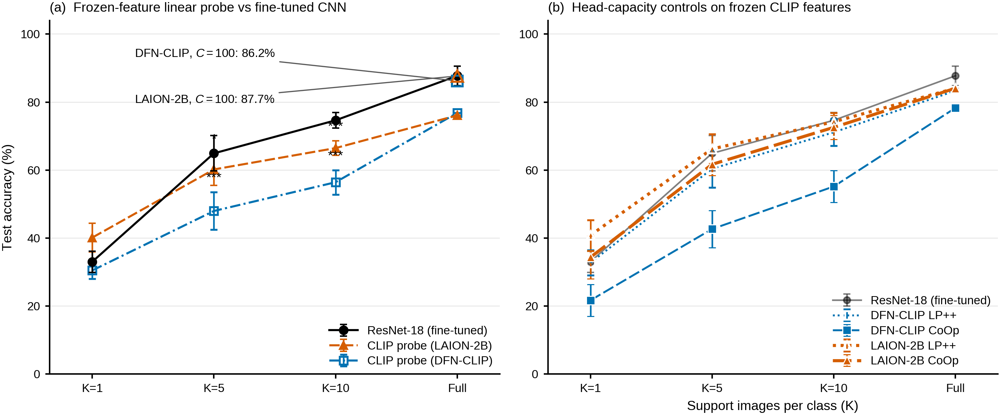

# Fine-Tuning or Frozen Probes? Empirical Applicability Boundaries for Off-the-Shelf CLIP in Tobacco Leaf-Disorder Diagnosis

Does a frozen CLIP encoder with a training-light head beat a fully fine-tuned
small CNN for classifying fine-grained leaf disease?

Short answer: it depends on the annotation budget, and the crossover is
reproducible. On 16-class tobacco images:

| Regime | Result |
|---|---|
| Zero-shot, no training | CLIP sits at the majority-class baseline. 13.0% is the baseline; the best of 14 templates reaches 14.5%, which is 2 images and not significant (exact McNemar p=0.87; p=0.999 under a selection-aware permutation test across all 14). |
| K=1 (1 image/class) | LAION-2B probe and ResNet-18 are statistically indistinguishable: 40.8% ± 4.6 (15 seeds, C selected on validation) vs 40.4%, paired p=0.84. DFN-CLIP trails significantly (32.5%, p=1.1e-5). |
| K=2 (2 images/class) | Same pattern: 53.0% ± 4.8 vs 52.5%, paired p=0.66; DFN-CLIP trails significantly (44.9%, p=1.8e-4). |
| K=5, K=10 | ResNet-18 wins under the matched protocol and the gap widens with K (74.0% / 79.2% vs 68.2% / 73.9%); with an extended low-LR tuning budget ResNet reaches 68.1% at K=5, matching the probe. |
| Full data | A validation-regularized probe on frozen CLIP is statistically indistinguishable from fine-tuned ResNet-18: 86.2% vs the 15-seed mean 87.7% ± 2.8, a 1.5 pp gap (15-seed mean-difference 95% CI [-0.1, +3.1] pp, one-sample t-test p=0.060; 10 of 15 seeds land above the probe and one matches it exactly). The 138-image test set cannot resolve a difference this small. |
| Full data, 5-fold CV | The better-powered comparison separates them: 89.4% vs 92.5%, ResNet ahead in all five folds. |
| Full data, matched tuning budget | Fine-tuning CLIP itself wins by a wide margin: 95.5% (DFN) / 94.9% (LAION) over 5 seeds, +7.2 to +7.8 pp over fine-tuned ResNet-18. |

Two consequences worth stating plainly. First, "CLIP or CNN" is not a property
of the encoders; it is a property of the regime, and the paper's primary
frozen-probe-vs-fine-tuned-CNN contrast is conservative for CLIP. Second,
the 138-image test set is too small to settle anything under about 3 pp, so
single-split top-1 differences below that threshold are reported as
indistinguishable rather than as wins.



*Accuracy vs. annotation budget on the 16-class tobacco set. Generated from `data/*.json` by `scripts/generate_figures.py --only fewshot_curve`.*

## Repository layout

```
figs/fig_fewshot_curve.png            headline result, generated from data/*.json
data/*.json                           experiment outputs — source of truth
scripts/                              every experiment behind a number
scripts/dataset.py                    TPDD dataset (vendored; see below)
scripts/model_zoo.py                  encoders + train/eval loops (vendored)
scripts/generate_figures.py           all four figures, from data/*.json only
scripts/check_tex_vs_data.py          consistency gate (run before committing)
refine-logs/P3*_PREREGISTRATION.md    pre-registered protocols for the matched-budget fine-tuning study
```

`data/*.json` is the single source of truth. The manuscript is written against
those files, not the other way round.

**The manuscript itself is not in this repository** — it is under review at the
journal; it is available from the authors. This repository holds the code and
data that make every number in it independently re-derivable.

## Reproducing

The figure generator needs no GPU and takes seconds:

```bash
mkdir -p manuscript/paper/figures
python3 scripts/generate_figures.py  # writes manuscript/paper/figures/{pdf,svg,png}
```

`scripts/check_tex_vs_data.py` is the authors' consistency gate: it derives
each headline number from the JSON artifacts and asserts it appears in the
manuscript, that superseded values are *gone*, and that table rows match cell
by cell. It re-derives the Holm-adjusted p-values too, so the multiplicity
correction cannot regress. It requires the manuscript text, so it is an
author-side tool; every experiment script in this repository runs without it.

Re-running the experiments themselves needs a CUDA GPU (an RTX 4070 Ti was
used) plus the two model families:

```bash
python3 scripts/canonical_protocol.py       # frozen-feature probes, C sweep
python3 scripts/canonical_fig_artifacts.py  # deterministic features + paired preds
python3 scripts/cv_protocol.py              # 5-fold CV, both backbones
python3 scripts/clip_fewshot_probe.py       # K=1/2/5/10
python3 scripts/paired_kshot_a4.py          # seed-paired ResNet few-shot
python3 scripts/zero_shot_clean.py          # 14 templates, saves per-image preds
python3 scripts/clip_finetune.py --out data/clip_finetune.json   # 5 seeds x 2 ckpts
```

`data/_orig_baseline/` holds the outputs of the pre-rerun pipeline, kept so the
diff against current results is auditable. Do not read those numbers as current.

DINOv2 ViT-L/14 fine-tuning (the matched-budget control completing the
backbone axis; results in `data/dinov2_finetune_full_16.json` and
`data/dinov2_kshot_ft_k{1,2,5,10}*.json`, run on A100-80GB/PyTorch 2.9):

```bash
python3 scripts/dinov2_finetune_kshot.py --full   # or --k 1|2|5|10
```

Base weights: official LVD-142M pretrain from HuggingFace
(`facebook/dinov2-large`, `dinov2_vitl14_pretrain.pth`),
SHA256 `d5383ea8f4877b2472eb973e0fd72d557c7da5d3611bd527ceeb1d7162cbf428`.
Obtain the file and set `DINOV2_PTH` to its path (≈1.2 GB; not tracked here).
The script asserts the checksum before training.

## Data

**The image corpora are not in this repository.** Obtain them as follows:

| Corpus | Size | Source |
|---|---|---|
| TPDD | 52 MB | `TamAko783/TPDD_Honglin_CLS` (Hugging Face Hub) |
| TLD | 178 MB | see `data/tld_*_manifest.json` for the exact file list |
| PlantVillage tomato | 313 MB | public PlantVillage release |
| Field dataset (tobacco, 246 images) | 78 MB | available from the authors on request |

Expected layout, which `scripts/dataset.py` expects:

```
data/tpdd/
  train/       <class_name>/*.jpg  +  labels.json   (1295 images)
  validation/  <class_name>/*.jpg  +  labels.json   ( 138 images)
  test/        <class_name>/*.jpg  +  labels.json   ( 138 images)
```

`labels.json` is a list of `{"image": "<class>/<file>.jpg", "label": "<class>"}`.
Override the location with the `TPDD_DATA_ROOT` environment variable if you keep
the corpus elsewhere.

The four single-image test classes matter for reading the results: balanced
accuracy is dominated by them, and one of them (TSWV) accounts for most of the
balanced-accuracy gap between the two frozen backbones.

### A provenance problem you should know about

The original 11 MB low-resolution TPDD images were destroyed by an external
process on 2026-09-28, and they had never been tracked in git, so no earlier run
could be re-derived from the bytes it actually used. The corpus was rebuilt from
the public source at higher resolution. That moved the fine-tuned ResNet-18
full-data number from 86.4% to 87.7%: +1.3 pp, 1.8 SEM, Welch p=0.15, with 86.4%
inside the current run's 95% interval [86.3, 89.2]. Not statistically separable,
but no longer exactly reproducible either. The manuscript says so in the Fig. 4
caption.

If you depend on a corpus for a paper, keep a dated tarball outside the repo
and in git, or learn this the same way.

## Dependencies

Python 3.8; pinned versions in [`requirements.txt`](requirements.txt) (the exact
versions from the runs are also recorded in the `date`/`gpu`/`torch`/`open_clip`
fields of the JSON outputs):

```bash
pip install -r requirements.txt
```

## License

MIT — see [LICENSE](LICENSE).

## Citation

```bibtex
@article{long2026fine,
  title   = {Fine-Tuning or Frozen Probes? Empirical Applicability Boundaries for
             Off-the-Shelf CLIP in Tobacco Leaf-Disorder Diagnosis},
  author  = {Long, Chenfeng and Tan, Zhiyong and Deng, Yangjun and Luo, Xiang and Zhang, Lizhuo},
  journal = {Computers and Electronics in Agriculture (under review)},
  year    = {2026}
}
```
